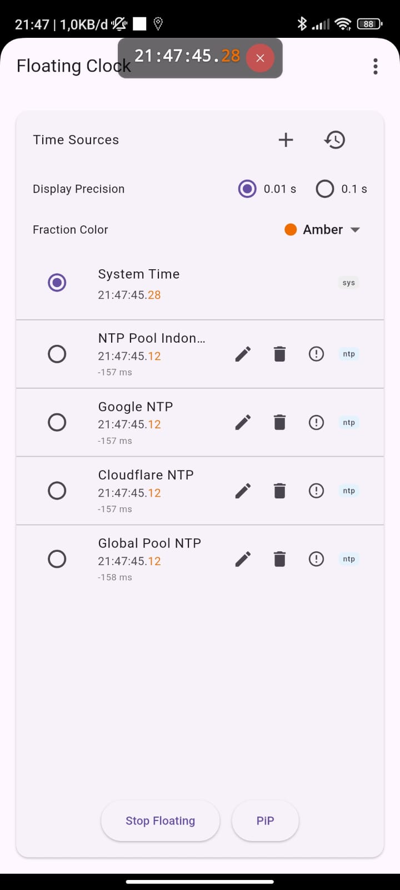
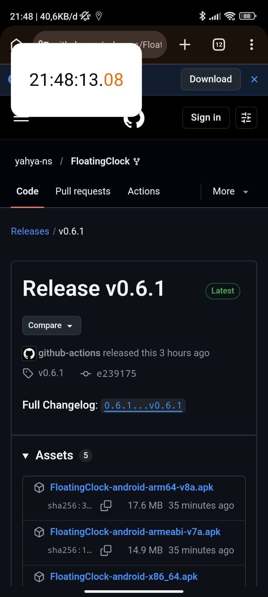

<div align="center">
  <h1>Floating Clock / Jam Melayang</h1>

  <p>
    <a href="README_EN.md">English</a> | 
    <a href="README_CN.md">简体中文</a> | 
    <b>Bahasa Indonesia</b>
  </p>

  
  
  <br/>
</div>
<br/>

Aplikasi Android berbasis Flutter yang ringan untuk menampilkan jam mengambang (*floating clock overlay*) di layar ponsel Anda. Mendukung sinkronisasi waktu dari berbagai sumber (NTP, HTTP, Sistem), kalibrasi selisih waktu (*offset*), serta mode *Picture-in-Picture* (PiP).

---

### ✨ Fitur Utama

- **Floating Clock Overlay**: Jam melayang di atas aplikasi lain yang dapat digeser (*drag-to-move*), dikunci posisinya (*pin*), atau ditutup dengan mudah.
- **Mode Picture-in-Picture (PiP)**: Menampilkan waktu jam dalam mode PiP bawaan sistem Android.
- **Multi-Sumber Waktu**: Mendukung sinkronisasi waktu dari Waktu Sistem, server **NTP** (*Network Time Protocol*), dan endpoint **HTTP**, lengkap dengan perhitungan offset (milidetik).
- **Preset NTP Indonesia & Global**: Dilengkapi preset server NTP andal secara bawaan:
  - `id.pool.ntp.org` (NTP Pool Indonesia)
  - `time.google.com` (Google NTP)
  - `time.cloudflare.com` (Cloudflare NTP)
  - `pool.ntp.org` (Global Pool NTP)
- **Kustomisasi Presisi Waktu**: Pilihan ketelitian waktu antara **0.1 detik** (`12:34:56.7`) dan **0.01 detik** (`12:34:56.78`), disertai pilihan warna sorotan (*highlight*) untuk pecahan detik.
- **Sinkronisasi Otomatis**: Melakukan sinkronisasi berkala di latar belakang dengan pencatatan waktu sinkronisasi terakhir.
- **Penyimpanan Lokal**: Menyimpan daftar server NTP kustom, preset, dan preferensi pengguna secara persisten menggunakan `shared_preferences`.
- **Dukungan Multi-Bahasa**: Mendeteksi bahasa sistem secara otomatis serta menyediakan opsi ganti bahasa di dalam aplikasi (English, 简体中文).

---

### 📁 Struktur Proyek

- `lib/main.dart`: Titik masuk utama aplikasi, inisialisasi tema, dan manajemen bahasa (`LocaleManager`).
- `lib/l10n/`: Definisi lokalisasi (i18n), kamus terjemahan, dan state bahasa.
- `lib/pages/`: 
  - `HomePage`: Antarmuka utama, daftar sumber waktu, timer sinkronisasi, dan kontrol overlay.
  - `AboutPage`: Halaman informasi versi dan detail aplikasi.
- `lib/models/`: Model data (`TimeSource`, `TimePrecision`) dan logika serialisasi JSON.
- `android/`: Kode native Android untuk overlay service (`FloatingClockService`), Picture-in-Picture, dan integrasi MethodChannel.
- `test/`: Pengujian unit dan widget (`test/widget_test.dart`).

---

### 🚀 Cara Menjalankan & Membangun

Pastikan Flutter SDK dan Android SDK sudah terpasang di komputer Anda.

```bash
# Mengambil dependencies
flutter pub get

# Menjalankan aplikasi pada perangkat / emulator yang terhubung
flutter run

# Menjalankan pengujian (unit/widget test)
flutter test

# Membangun APK rilis (teroptimasi & terpisah per arsitektur ABI)
flutter build apk --release --split-per-abi --obfuscate --split-debug-info=build/symbols
```
